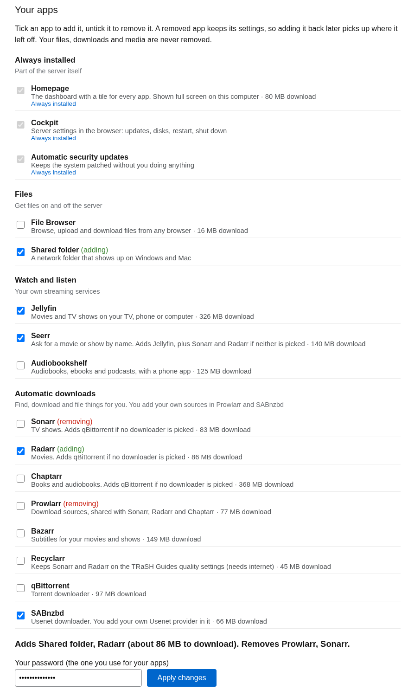
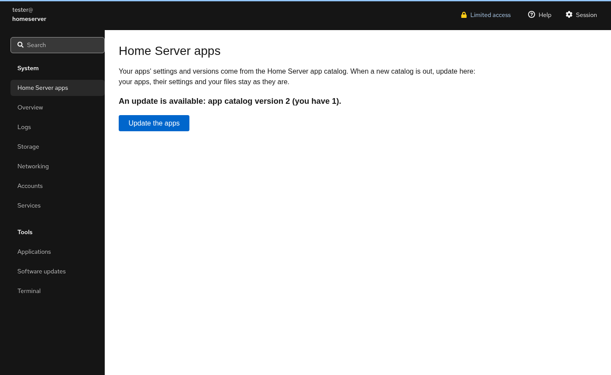
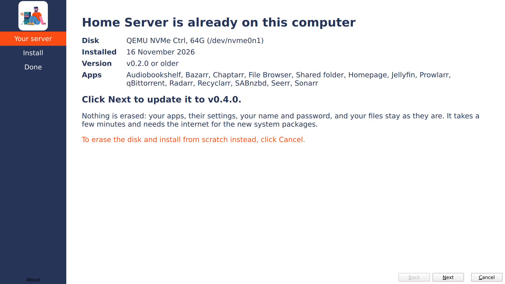

# homeserver-usb

A USB stick that turns any spare computer into a home server, for people who have never used Linux.

You flash one file onto a USB stick, boot the computer from it, and answer a few questions in a
point-and-click installer: language, which disk to use, which apps you want, your name and a
password. It installs Debian with Docker, sets up the apps you picked, connects them to each other,
and leaves the computer showing a dashboard with everything on it. No terminal at any point.

The stick holds Debian and the installer. The apps, their settings and the exact version of each
come from the [app catalog](catalog/) in this repository: the installer downloads the newest signed
catalog release, and installed servers add, remove and update apps from it later in the browser.
Connect the computer to your router with a cable (best) or Wi-Fi. Without internet the system still
installs, but with only the dashboard and Cockpit; add the other apps later from the **Apps** page once
it's online.

## What you get

Every app in the catalog has its own checkbox in the installer, and all of them except Tailscale are
ticked by default. Apps that another app needs are added automatically (Seerr adds Jellyfin; Sonarr,
Radarr and Chaptarr add qBittorrent if no downloader is ticked). Homepage is always installed.

| App | What it's for |
|---|---|
| [Homepage](https://gethomepage.dev) | The dashboard, shown full screen on the server and on `http://homeserver.local`. Apps appear on it through Docker labels, with live status, and open in a new tab |
| [File Browser](https://filebrowser.org) | Browse, upload and download files from a browser |
| Shared folder | A Samba share (`\\homeserver\Media`) that shows up on Windows and Mac |
| [Jellyfin](https://jellyfin.org) | Movies and shows, with the libraries already created |
| [Seerr](https://github.com/seerr-team/seerr) | Request a movie or show; signed in through Jellyfin and linked to Sonarr and Radarr |
| [Audiobookshelf](https://www.audiobookshelf.org) | Audiobooks, ebooks and podcasts, with the libraries already created |
| Sonarr, Radarr, [Chaptarr](https://hub.docker.com/r/chaptarr/chaptarr) | TV, movies, and books/audiobooks, each linked to every installed downloader with its own category |
| Prowlarr | Download sources, shared with Sonarr, Radarr and Chaptarr, and linked to the downloaders for grabbing straight from a search (category `prowlarr`) |
| Bazarr | Subtitles in the installer's language and English, linked to Sonarr and Radarr, from sources that need no account (add OpenSubtitles with your own account for more) |
| [Recyclarr](https://recyclarr.dev) | Keeps Sonarr and Radarr on the TRaSH Guides profiles |
| qBittorrent | Torrent downloader |
| [SABnzbd](https://sabnzbd.org) | Usenet downloader; you add your own Usenet provider |
| [Tailscale](https://tailscale.com) | The dashboard and apps from your phone or laptop away from home, with a free Tailscale account and no router changes. Not ticked by default; the Apps page shows the link to connect it |

Always installed: [Cockpit](https://cockpit-project.org) for server settings (port 9090: updates,
disks, restart, shut down), a **Home Server apps** page in Cockpit for app updates, and automatic
security updates. All of them have a tile in the Server row at the bottom of the dashboard.

Each app runs the exact version pinned in [`catalog/compose.yaml`](catalog/compose.yaml) (tag and
digest), never `latest`. The images come straight from their publishers; a new catalog release is
what moves them.

Every app is configured during the install, and all of them use the **name and password typed in the
installer**. The only things left to do are adding your indexers in Prowlarr and, for Usenet, your
provider in SABnzbd.

The download setup follows the [TRaSH Guides](https://trash-guides.info):

- One `/data` folder shared by every app, so finished downloads are hardlinked into the library
  instead of copied: `/srv/data/torrents/...` for qBittorrent, `/srv/data/usenet/...` for SABnzbd and
  `/srv/data/media/...` for the libraries.
- qBittorrent (automatic torrent management) and SABnzbd use one category per media type.
- Sonarr and Radarr have hardlinks, subtitle import and "do not prefer" propers. Recyclarr syncs the
  TRaSH WEB-1080p (Sonarr) and HD Bluray + WEB (Radarr) profiles, custom formats and the Jellyfin
  naming schemes daily, and Seerr requests use those profiles.

### Disks

The disk you pick is split into EFI, `/boot`, swap, `/` (30%, 20–50 GB), `/home` (10%, 5–10 GB) and
`/srv` (the rest) for app settings and media. There's also a manual option. The disk always gets a
GPT partition table; on older computers that boot in BIOS (legacy) mode, a small BIOS boot partition
is added for GRUB, and GRUB always goes on the disk you picked.

Other drives in the computer can be ticked on the next page. They're **erased** and pooled with the
main drive's media folder using [mergerfs](https://github.com/trapexit/mergerfs): every drive keeps
its own filesystem, so a dead drive only loses the files that were on it, and any drive can be read
on another computer. New folders go to the drive with the most free space, and their contents stay
together. When a download and its library folder end up on different drives, the app copies the
file instead of hardlinking it.

## Install

The [step-by-step guide with screenshots](docs/install-guide.md) walks through all of it. In short:

1. Download `homeserver-usb.iso` from [Releases](../../releases).
2. Flash it to a USB stick (8 GB or bigger) with [balenaEtcher](https://etcher.balena.io) or
   [Rufus](https://rufus.ie). If Rufus asks, choose **DD Image mode**.
3. Plug the stick into the computer that will become the server, connect it to your router with a
   network cable, and boot from the stick (usually F12, F11 or Esc at power-on). No cable? The
   installer asks for your Wi-Fi first.
4. Follow the installer. **The disk you pick is erased.**
5. When it's done the computer turns off. Pull out the stick and turn it back on.
6. The dashboard opens on the server's screen. From any other device at home, open
   `http://homeserver.local`.
7. In Prowlarr ("Download sources" on the dashboard), add your indexers.

Needs a 64-bit PC with 4 GB of RAM and a 64 GB disk.

## Adding and removing apps

Click **Apps** on the dashboard (or open Cockpit's **Home Server apps** page) and log in. Under
**Your apps**, tick an app to add it or untick it to remove it, type your password and click **Apply
changes**. The same rules as in the installer apply: apps another app needs are added with it and
can't be unticked while it's there (Seerr keeps Jellyfin), and the always-installed apps stay.

New apps are downloaded at the versions in the server's catalog and set up like in the installer:
your name and password, and connected to the apps already there. A removed app's container and image
are deleted and the other apps forget it (Sonarr drops a removed downloader, Prowlarr and Seerr drop
a removed Sonarr or Radarr). Its settings stay in `/srv/appdata`, so adding it back picks up where it
left off. Downloads and media are never touched.



## Updating

Nothing is erased by either kind of update: apps, their settings, your name and password, and your
files stay as they are.

**From the dashboard (the usual way).** Click **Apps** on the dashboard. When a newer app catalog is
out, type your password and click **Update the apps**. It downloads the catalog and checks its
signature, then:

- installs the Home Server files the catalog carries (scripts, services, this Cockpit page, the sudo
  rule) and any Debian packages they need, unless the server already has newer ones;
- moves the apps to the newly pinned versions;
- applies every app's settings and links again (logins, download clients, libraries, Prowlarr, Seerr,
  Recyclarr, the dashboard), so a catalog that changes how apps are set up reaches servers that
  already have them.

If the update fails, the previous catalog is put back. Since 0.5.0 this covers everything except
reinstalling and a new Debian release, so a new USB stick is rarely needed.



**From a new USB stick.** Servers from before 0.4.0 have no app catalog yet and need this once.
Flash the new `homeserver-usb.iso` and boot the server from it. The stick finds Home Server on the
disk and offers to update it instead of reinstalling: it adds the system packages the new version
needs (needs internet), replaces the Home Server scripts and services (unless the server already has
newer ones from the catalog), and installs the newest app catalog. Without the password, the next
start applies the settings that only need the apps' own keys. Click **Cancel** on that page to erase
the disk and install from scratch instead.



## How it works

- `live/` is a [live-build](https://live-team.pages.debian.net/live-manual/) config for a Debian 13
  live system that boots straight into [Calamares](https://calamares.io), full screen, with no desktop.
- `installer/` holds the Calamares settings, branding, and a small Python step
  (`usr/lib/calamares/modules/homeserver`) that saves your choices.
- `catalog/` is the app catalog: `catalog.json` (the apps, the installer's checklist, which apps
  need which, download and disk sizes), `compose.yaml` (every app, pinned), `setup.py` and
  `configure-apps.sh` (configure the apps and connect them through their APIs), `apps.sh` (add and
  remove apps on a running server), `update.sh` (what a server runs after taking a new catalog) and
  `server.sh` (installs the Home Server files a release carries). `bundle.sh` adds the repo's
  `server/` tree and package list to each release. It's published as signed releases and installed
  on each server in `/var/lib/homeserver/catalog`. The ISO also carries a minimal copy (dashboard and
  Cockpit only) for installs without internet.
- `server/` is copied onto the installed system. `catalog.sh` downloads catalog releases and checks
  their signature. `setup-drives.sh` erases and pools any extra drives. At the end of the install,
  `install-apps.sh` starts a temporary Docker daemon that writes to the new disk and runs the
  catalog's `configure-apps.sh` for the apps you picked. If that fails, the installed system retries
  it on its first start. `update-setup.sh` and `update-system.sh` are the USB stick's update mode;
  `usr/share/cockpit/homeserver` is the Cockpit page, which runs `catalog.sh update` and `catalog.sh
  apps` through a sudo rule that allows only those two.
- The screen shows the dashboard in Firefox running under [cage](https://github.com/cage-kiosk/cage).

## Build it yourself

You need Docker and about 15 GB of free disk:

```bash
./build.sh             # writes out/homeserver-usb.iso
test/vm.sh --reset     # boots it in a VM as a USB stick, with two empty disks (64 GB, 500 GB)
test/vm.sh --window    # same, in a window you can click through
test/vm.sh --disk      # boots the installed VM
test/vm.sh --iso F     # boots another ISO, e.g. an older release, to test updating
```

To test a catalog before releasing it, serve a signed `catalog.tar.gz` (and `.sig`) over HTTP and
point the installer at it with `homeserver.catalog=http://...` on the boot line, or an installed
server with `/etc/homeserver/catalog-url`. Either way it must be signed by a key in
`catalog-signers`.

## Releasing the app catalog

Change what you need in `catalog/` or `server/`, raise `"version"` in `catalog.json`, test it,
commit, then:

```bash
catalog/release.sh ~/path/to/catalog-signing-key
```

It bundles `catalog/` with `server/` and the package list, signs `catalog.tar.gz` with
`ssh-keygen -Y sign`, checks the signature against
`server/usr/share/homeserver/catalog-signers` (the public key every ISO and server trusts), and
uploads it to two GitHub releases: `catalog-vN`, kept for history, and `catalog`, which installers
and servers download. It refuses a version that isn't newer than the published one, and
uncommitted changes. Servers never go back to older Home Server files: each release records when
`server/` last changed (`server-rev`), and so does each ISO.

## Dashboard look

The **Dashboard look (Homepage)** section of the Apps page changes the dashboard's title, light or
dark theme, accent color and background picture, for every screen at once. Pick one of the built-in
pictures or upload your own (JPEG, PNG or WebP, up to 15 MB). Uploading only works from another
computer or phone: the server's own screen can't open a file window, so the built-in pictures are
there for it. Saving restarts Homepage, so reload it a few seconds later.

To go further, edit Homepage's files in `/srv/appdata/homepage` (see
[its docs](https://gethomepage.dev/configs/)). Home Server writes `services.yaml`, `settings.yaml`,
`widgets.yaml`, `docker.yaml` and `custom.js` again on every update and whenever the server's address
changes, but only above the line that says "Your own additions go below this line": put your groups,
widgets and settings below it and they're kept. A setting you add there replaces Home Server's.
`bookmarks.yaml` is all yours. Updating from catalog 11 or older keeps a copy of the old files in
`before-catalog-12/`.

## Remote access

With the Tailscale app installed, the Apps page has a **Remote access** section. Until the server is
connected it shows a login link: open it on any device, sign in to Tailscale (or create a free
account) and approve the server. Then install the Tailscale app on your phone or laptop, sign in to
the same account, and open `http://homeserver/` (or the `100.x.y.z` address the page shows) from
anywhere. The dashboard tiles follow whatever address the dashboard was opened with. **Disconnect**
logs the server out of Tailscale.

## Security notes

This is meant for a home network. The dashboard has no login, and everything uses plain HTTP.
Don't forward these ports to the internet; for access away from home use the Tailscale app, which
only lets in devices signed in to your own Tailscale account.

The app catalog runs as root on every server, so servers only accept a catalog signed with the
Home Server key, and never one older than what they have. That key is kept offline, not on GitHub;
taking over the repository isn't enough to push code to servers. Cockpit's app update button can
run without administrative access because of one sudo rule
(`/etc/sudoers.d/homeserver-catalog`) that allows exactly `catalog.sh update`, `apps`, `look` and
`remote status|logout`; the first two only use signed releases.

## Known issues

- The server's own screen can't open a file window (Firefox runs full screen under cage, which
  doesn't show it), so uploading a background picture or a file has to be done from another device.

- Firefox on the server's screen shows "This connection is not secure" under login forms, and it can
  cover the password box. Every app is plain HTTP inside the home network, so it's expected; click
  an empty part of the page to dismiss it, then click the box you want to type in.
- Right after a reboot some dashboard tiles can show "API Error" while their app is still
  starting. The dashboard reloads itself until they're up.

## Contributing

See [CONTRIBUTING.md](CONTRIBUTING.md). Security problems: [SECURITY.md](SECURITY.md).

## License

MIT
